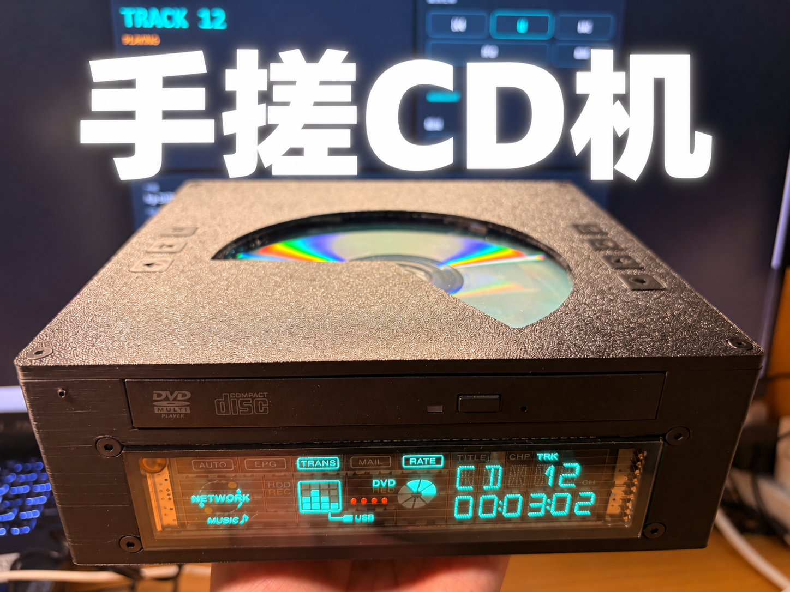

# Lyra CD Player



Lyra CD Player 是一台以旧式光驱为播放机构、ESP32-S3 为控制核心，并集成功放、耳放、线路输出与显示模块的紧凑型 CD 播放器。本仓库提供 VFD 与 OLED 两种显示版本的固件、烧录说明和用户手册。

> 当前稳定版本：**V1.3**
>
> 作者：**谷谷哒**
>
> 适用硬件：**Lyra CD Player V1.3 / ESP32-S3 / 16 MB Flash**
>
> 显示版本：**FUTABA VFD** 或 **1.54 英寸 SSD1309 128×64 I²C OLED（默认地址 0x3C）**

## 主要功能

- CD 播放、暂停、上一曲、下一曲与数字选曲
- 0～20 级音量调节
- 内置扬声器、3.5 mm 耳机和线路输出三种输出通道
- VFD 或 1.54 英寸 SSD1309 OLED 显示曲目、播放时间、频谱与输出状态
- 实体按键与红外遥控器控制
- ESP32-S3 Wi-Fi 热点及网页控制界面
- 旧光驱再利用，集成解码、耳放与功放的小型化设计

## 下载

请从 [Releases](https://github.com/GGD-create/Lyra-CD-Player/releases/latest) 下载。V1.3 提供以下文件：

| 文件 | 用途 |
| --- | --- |
| `Lyra_CD_Player_V1.3_full.bin` | 完整安装镜像，从 `0x0` 烧录；包含 bootloader、分区表和应用固件 |
| `Lyra_CD_Player_V1.3_app.bin` | 仅应用固件，从 `0x10000` 烧录；用于分区表兼容的 V1.3 设备升级 |
| `Lyra_CD_Player_V1.3_flash_bundle.zip` | 三个原始 BIN、地址说明、Windows 烧录脚本和许可文件 |
| `Lyra_CD_Player_V1.3_OLED_1.54_SSD1309_full.bin` | 1.54 英寸 SSD1309 OLED 版本完整镜像，从 `0x0` 烧录 |
| `Lyra_CD_Player_V1.3_OLED_1.54_SSD1309_app.bin` | 1.54 英寸 SSD1309 OLED 版本应用固件，从 `0x10000` 烧录 |
| `SHA256SUMS_OLED.txt` | OLED 版本固件完整性校验值 |
| `Lyra_CD_Player_User_Manual_V1.3.pdf` | 8 页中文用户说明 |
| `SHA256SUMS.txt` | 下载文件完整性校验值 |

直接下载：VFD [完整固件](https://github.com/GGD-create/Lyra-CD-Player/releases/latest/download/Lyra_CD_Player_V1.3_full.bin) / [应用固件](https://github.com/GGD-create/Lyra-CD-Player/releases/latest/download/Lyra_CD_Player_V1.3_app.bin) · OLED [完整固件](https://github.com/GGD-create/Lyra-CD-Player/releases/latest/download/Lyra_CD_Player_V1.3_OLED_1.54_SSD1309_full.bin) / [应用固件](https://github.com/GGD-create/Lyra-CD-Player/releases/latest/download/Lyra_CD_Player_V1.3_OLED_1.54_SSD1309_app.bin) · [烧录包](https://github.com/GGD-create/Lyra-CD-Player/releases/latest/download/Lyra_CD_Player_V1.3_flash_bundle.zip) · [用户手册](https://github.com/GGD-create/Lyra-CD-Player/releases/latest/download/Lyra_CD_Player_User_Manual_V1.3.pdf)

> **请勿混刷显示版本。** OLED 固件仅适用于 **1.54 英寸 SSD1309、128×64、I²C 接口**的屏幕模块，默认从机地址为 `0x3C`。VFD 机器请继续使用原有 VFD 固件。

## 烧录前准备

1. 安装 Python 3，并执行：

   ```powershell
   py -m pip install --upgrade esptool
   ```

2. 使用可传输数据的 USB 线连接设备，确认串口号（例如 `COM5`）。
3. 设备无法自动进入下载模式时：按住 **BOOT**，短按 **RESET**，松开 **BOOT**。
4. 仅将本固件用于上述指定硬件。错误的板型、Flash 容量、分区表或接线可能导致设备无法启动。

## 方式一：完整安装

完整安装会擦除整个 Flash，包括 Wi-Fi、设备设置和其他 NVS 数据。

```powershell
py -m esptool --chip esp32s3 --port COM5 erase-flash
py -m esptool --chip esp32s3 --port COM5 --baud 460800 write-flash --flash-mode dio --flash-freq 80m --flash-size 16MB 0x0 Lyra_CD_Player_V1.3_full.bin
```

也可解压烧录包，在其目录运行：

```bat
flash_full.bat COM5
```

## 方式二：仅升级应用固件

此方式不擦除 NVS，通常可保留网络和设备设置；**仅适用于分区表兼容的 Lyra CD Player V1.3 设备**。

```powershell
py -m esptool --chip esp32s3 --port COM5 --baud 460800 write-flash --flash-mode dio --flash-freq 80m --flash-size 16MB 0x10000 Lyra_CD_Player_V1.3_app.bin
```

或在解压后的烧录包目录运行：

```bat
flash_app_only.bat COM5
```

## 网页控制

设备启动热点后：

- Wi-Fi：`GGD-CD-PLAYER`
- 密码：`GGDCD2026`
- 浏览器地址：`http://192.168.4.1`

`192.168.4.1` 是设备热点局域网地址。电脑或手机必须先连接上述热点，才能打开控制页面；该地址不是公网网站。

## 常见问题

**找不到串口**

更换支持数据传输的 USB 线，检查驱动和设备管理器，并关闭正在占用串口的程序。

**提示无法连接芯片**

按住 BOOT、短按 RESET、松开 BOOT 后重试，并确认选择了正确串口。

**烧录完成但不能启动**

确认使用 ESP32-S3、DIO、80 MHz、16 MB 参数。首次安装应使用完整镜像从 `0x0` 烧录；必要时先擦除 Flash。

**升级后设置异常或不断重启**

可能存在分区表或 NVS 不兼容。备份必要设置后执行完整安装。

**无法打开网页控制**

确认已连接 `GGD-CD-PLAYER`，关闭移动数据或代理后访问 `http://192.168.4.1`。

## 使用与安全提示

- 仅使用 `DC 12V 5A、中心正极` 电源。
- 放入或取出 CD 时，必须用一只手托住托盘底部，另一只手操作光盘；禁止在托盘悬空时向下按压。
- 禁止带电拆机、直视光驱内部光路，或使用破裂、严重变形、标签翘起的光盘。
- 更完整的操作与安全说明请阅读用户手册。

## 许可与第三方声明

固件的使用与分发条件详见 [FIRMWARE-LICENSE.txt](FIRMWARE-LICENSE.txt)。

固件中包含或改编自第三方许可组件。第三方组件仍适用其各自许可，不受本项目闭源条款覆盖。详情见 [THIRD_PARTY_NOTICES.txt](THIRD_PARTY_NOTICES.txt)。

产品与固件按“现状”提供。作者不对误接电源、错误烧录、错误操作、擅自改装、硬件差异或由此产生的直接或间接损失承担责任。

Copyright © 2026 谷谷哒。保留所有权利。
